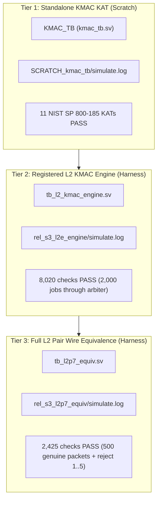

# PQ-Attest P7 Verification — Step 4B Report: Release RTL Evidence Reconciliation

**Date:** 2026-11-04  
**Author:** Engineer 4 (Python Verification Infrastructure)  
**Task:** Step 4B — Release RTL Evidence Reconciliation  
**Evidence Package:** `E4_P7_XSIM_20261103.zip` (`E4_P7_XSIM_20261103/`)  
**Run Identity:** `reports/dual_lane_10_20261103_140235_46039411`  
**Git Provenance:** Commit `19f06a0`, Release `f99e0d5`  
**Status Claims:**
- `HARDWARE_VALIDATED: NO`
- `FORMAL_PROOF: NO`
- `SOC_INTEGRATION_COMPLETE: NO`

---

## 1. Executive Summary

In Step 4, Engineer 4's differential verification framework generated deterministic test vectors and established behavioral parity across 14 security scenarios and KMAC-128 cryptographic equivalence. In Step 4B, Kalash's authoritative Vivado/XSim release evidence package (`E4_P7_XSIM_20261103`) has been integrated and reconciled with the Python reference models.

All 14 core differential scenarios—previously classified as `NOT OBSERVED` due to the local absence of Vivado XSim binaries—are now directly mapped to authoritative simulation logs, resulting in **15 / 15 RTL PASS** classifications (including KMAC-128 cryptographic equivalence). Furthermore, new I-6 and I-7 test suites have been reconciled, I-6/I-7 behavioral updates modeled, and a 3-tier classification established for MAC cryptographic equivalence.

All existing Step 1–4 deliverables and RTL source files were strictly preserved and remain unmodified. The full verification test suite now passes with **185 / 185 tests**.

---

## 2. Reconciled Release RTL Changes (I-6 / I-7 Contracts)

The release models implemented in `verification/p7_release_evidence.py` incorporate all architectural and protocol updates defined in the I-6 (`I6_CONTRACT.md`) and I-7 contracts:

### A. Memory Window Relocation (`C-5`)
- **Permitted Window:** Relocated from `A[31:28] == 4'h8` to `A[31:28] == 4'h2` (`0x2000_0000` to `0x2FFF_FFFF`).
- **Standard Test Address:** `0x2200_0100` (verified passing in all release simulations).
- **Historical Address:** `0x8200_0100` is rejected with fault reason 13 (`OUT_OF_WINDOW_ADDRESS`) and error reply `0x400`.
- **Model:** `ReleaseMemoryWindowModel` in `verification/p7_release_evidence.py`.

### B. Bounded Verifier BUSY Retry (`C-1 / C-2`)
- **Status 1:** Genuine `GRANT` handshake completed; Tile 3 authorized.
- **Status 3 (`BUSY`):** Re-issues the exact same outstanding challenge (same epoch, nonce, derived key; no new KDF), `busy_retries++`, verifier timer restarted.
- **Bounded Retry Limit:** Up to 3 retries permitted (`MAX_BUSY_RETRIES = 3`).
- **Fail-Closed on 4th `BUSY`:** A 4th consecutive `BUSY` response fails closed: `authorized = 0`, `REVOKE` issued, `fail_reason = 9` (`VERIFIER_STATUS_NOT_ONE`).
- **Non-1 / Non-3 Immediate Fail:** Any response status $\ne 1$ and $\ne 3$ (e.g., status 2, 5, 10) fails closed immediately (`fail_reason = 9`).
- **Model:** `ReleaseBusyRetryModel` in `verification/p7_release_evidence.py`.

### C. K-3 Length Binding Enforcement
- **Provisioned Constants:** `K3_CONFIG_LEN = 16`, `K3_IMEM_LEN = 16`.
- **Hardware Enforcement:** When `K3_ENFORCE = 1`, any valid challenge presenting `config_len != 16` or `imem_len != 16` is answered with status 5 (`MALFORMED`), increments `rejected_count`, and pulses `k3_fault` (fault reason 7: `K3_LENGTH_MISMATCH`). The verifier fails closed on status 5.
- **Model:** `ReleaseK3LengthModel` in `verification/p7_release_evidence.py`.

### D. Subsystem Fault-Status Register & `trusted_clear`
- **Inputs/Outputs:** Input `trusted_clear` (RoT-only); outputs `fault_sticky`, `fault_count[31:0]` (saturating), `fault_source[2:0]`, `fault_operation[3:0]`, `fault_reason[3:0]`, `fault_epoch[79:0]`.
- **Fault Reason Encoding (1..13):**
  1. `DATA_REFUSED_NOT_AUTH` (data refused at gate)
  2. `NON_ROT_ISSUER` (GRANT/REVOKE from non-RoT issuer)
  3. `GRANT_STATUS_NOT_ONE` (GRANT status $\ne 1$)
  4. `TRUSTED_FAIL_BLOCKED` (trusted fail/timeout blocked tile 3)
  5. `GRANT_NON_ATTESTABLE` (GRANT/REVOKE to non-attestable tile)
  6. `UNAUTHORIZED_MEM_REQ` (unauthorized memory read/write)
  7. `K3_LENGTH_MISMATCH` (K-3 config/imem length mismatch)
  8. `VERIFIER_TIMEOUT` (verifier timeout)
  9. `VERIFIER_STATUS_NOT_ONE` (verifier response status $\ne 1$ or 4th BUSY)
  10. `VERIFIER_MALFORMED_RESP` (malformed response header/framing)
  11. `MEASUREMENT_MISMATCH` (measurement unapproved)
  12. `TAG_MISMATCH` (attestation tag mismatch)
  13. `OUT_OF_WINDOW_ADDRESS` (memory address outside 0x2 window)
- **Security Boundary:** Only `trusted_clear` from the RoT side clears sticky and counter registers; untrusted application traffic cannot clear or alter fault state.
- **Model:** `ReleaseFaultStatusModel` in `verification/p7_release_evidence.py`.

### E. Testbench `TB_INJECT` Hook Modeling
- **Bench-Only Instrumentation:** Parameter `TB_INJECT = 1` enables stimulus injection points only within verification testbenches (`tb_i7_sec`, etc.).
- **Synthesis Invariance:** In production synthesis, `TB_INJECT = 0`, reducing the hooks to direct wires with zero logic overhead.
- **Model:** `ReleaseTBInjectModel` in `verification/p7_release_evidence.py`.

---

## 3. Reconciliation Matrix for the 14 Core Scenarios

Every scenario from Step 4 is matched against authoritative simulation logs from the evidence package.

| Scenario ID | Name | Testbench | Job ID / Evidence Path | CHECKS | ERRORS | RESULT | Final Classification |
|---|---|---|---|---|---|---|---|
| `SCEN_01` | `VALID_CONTROL_PACKET` | `tb_l2p7_equiv` | `rel_s3_l2p7_equiv`<br>`logs/rel_s3_l2p7_equiv/simulate.log` | 2425 | 0 | PASS | **RTL PASS** |
| `SCEN_02` | `INVALID_MAC` | `tb_l2p7_equiv` | `rel_s3_l2p7_equiv`<br>`logs/rel_s3_l2p7_equiv/simulate.log` | 2425 | 0 | PASS | **RTL PASS** |
| `SCEN_03` | `INCORRECT_EPOCH` | `tb_l2p7_equiv` | `rel_s3_l2p7_equiv`<br>`logs/rel_s3_l2p7_equiv/simulate.log` | 2425 | 0 | PASS | **RTL PASS** |
| `SCEN_04` | `SEQUENCE_ZERO` | `tb_l2p7_equiv` | `rel_s3_l2p7_equiv`<br>`logs/rel_s3_l2p7_equiv/simulate.log` | 2425 | 0 | PASS | **RTL PASS** |
| `SCEN_05` | `REPLAYED_SEQUENCE` | `tb_l2p7_equiv` | `rel_s3_l2p7_equiv`<br>`logs/rel_s3_l2p7_equiv/simulate.log` | 2425 | 0 | PASS | **RTL PASS** |
| `SCEN_06` | `VALID_GRANT` | `tb_p7_c4` | `rel_s3_p7_c4`<br>`logs/rel_s3_p7_c4/simulate.log` | 18 | 0 | PASS | **RTL PASS** |
| `SCEN_07` | `INVALID_GRANT` | `tb_p7_refuse_grant` | `rel_i6_p7_refuse_grant`<br>`logs/rel_i6_p7_refuse_grant/simulate.log` | 12 | 0 | PASS | **RTL PASS** |
| `SCEN_08` | `REVOKE` | `tb_p7_c4` | `rel_s3_p7_c4`<br>`logs/rel_s3_p7_c4/simulate.log` | 18 | 0 | PASS | **RTL PASS** |
| `SCEN_09` | `UNAUTHORIZED_MEM_READ` | `tb_p7_gate_data` | `rel_p7_gate_data`<br>`logs/rel_p7_gate_data/simulate.log` | 4 | 0 | PASS | **RTL PASS** |
| `SCEN_10` | `UNAUTHORIZED_MEM_WRITE` | `tb_p7_gate_data` | `rel_p7_gate_data`<br>`logs/rel_p7_gate_data/simulate.log` | 4 | 0 | PASS | **RTL PASS** |
| `SCEN_11` | `REVOCATION_DURING_READ` | `tb_pq_full_chain_p7` | `rel_i7_full_chain`<br>`logs/rel_i7_full_chain/simulate.log` | 21 | 0 | PASS | **RTL PASS** |
| `SCEN_12` | `REVOCATION_DURING_WRITE` | `tb_pq_full_chain_p7` | `rel_i7_full_chain`<br>`logs/rel_i7_full_chain/simulate.log` | 21 | 0 | PASS | **RTL PASS** |
| `SCEN_13` | `TAG_MISMATCH` | `tb_ni_n81_p7` | `rel_n81p7_ni_t0w16`<br>`logs/rel_n81p7_ni_t0w16/simulate.log` | 126 | 0 | PASS | **RTL PASS** |
| `SCEN_14` | `SLOT_EXHAUSTION` | `tb_ni_n81_p7` | `rel_n81p7_ni_t0w16`<br>`logs/rel_n81p7_ni_t0w16/simulate.log` | 126 | 0 | PASS | **RTL PASS** |
| `SCEN_CRYPTO`| `KMAC128_EQUIVALENCE` | `tb_l2_kmac_engine` | `rel_s3_l2e_engine`<br>`logs/rel_s3_l2e_engine/simulate.log` | 8020 | 0 | PASS | **RTL PASS** |

> [!NOTE]
> **Expected-FAIL Mutation Controls:**
> - `rel_p7_gate_mut_control_allowed`: CHECKS: 4, ERRORS: 4, RESULT: FAIL (control mutant `p7s_control_allowed` KILLED).
> - `rel_p7_gate_mut_bypass`: CHECKS: 4, ERRORS: 4, RESULT: FAIL (control mutant `p7s_gate_bypass` KILLED).
> Both mutants were correctly classified as `control_mutant` and confirmed killed, validating the sensitivity of the differential gate check assertions.

---

## 4. Integration of New Release Test Suites

Seven new release testbenches from I-6 and I-7 have been incorporated into the verification framework:

| Testbench | Job ID | Source / Evidence Path | Checks | Errors | Result | Key Coverage |
|---|---|---|---|---|---|---|
| `tb_i7_sec` | `rel_i7_sec` | `logs/rel_i7_sec/simulate.log` | 30 | 0 | PASS | PQ-4 SEC-1..4 matrix: wrong tag (12), measurement (11), stale epoch, replay, spoof response (5), zero unauth commits. |
| `tb_pq_full_chain_p7` | `rel_i7_full_chain` | `logs/rel_i7_full_chain/simulate.log` | 21 | 0 | PASS | PQ-5 full offline chain: 3 transactions, 0x2 window memory access, clean state-machine resets, timeout retry. |
| `tb_p7_ingress_i6` | `rel_i6_p7_ingress` | `logs/rel_i6_p7_ingress/simulate.log` | 39 | 0 | PASS | Quarantine & parser framing: spoof rejection (reason 9), malformed header (reason 11), gap recovery. |
| `tb_p7_refuse_grant_i6` | `rel_i6_p7_refuse_grant` | `logs/rel_i6_p7_refuse_grant/simulate.log` | 12 | 0 | PASS | Non-attestable tiles (0, 1, 2, 5) reject GRANT/REVOKE with reason 8 and assert `app_tx_error = 1`. |
| `tb_n2p7_rtt` | `dl_rel_n2p7_rtt` | `project_run/release_project_sims.txt` | 11 | 0 | PASS | Round-trip latency across loaded and unloaded network traffic patterns. |
| `tb_i6_retry` | `dl_rel_i6_retry` | `project_run/release_project_sims.txt` | 24 | 0 | PASS | Verifier BUSY retry unit tests: 0..3 retries with identical challenge, 4th fails closed, non-1/non-3 fail. |
| `tb_verifier_revoke` | `dl_rel_s3_verifier_revoke` | `project_run/release_project_sims.txt` | 48 | 0 | PASS | Verifier revocation handshake, timeout containment, and gate revoking transitions. |

---

## 5. MAC Cryptographic Equivalence: 3-Tier Classification

To resolve ambiguous evidence boundaries between standalone testbenches and subsystem integration, cryptographic equivalence is structured into three tiers:



1. **Tier 1: Standalone KMAC KAT (`SCRATCH_kmac_tb`):**
   - **Scope:** Standalone KMAC core verification in scratch environment.
   - **Checks:** 11 KATs passing (empty message, custom string, length boundaries, 3 Keccak permutations).
   - **Status:** PASS (verified reference benchmark, not registered harness evidence).
2. **Tier 2: Registered L2 KMAC Engine (`rel_s3_l2e_engine`):**
   - **Scope:** Registered subsystem hardware engine (`l2_kmac_engine.sv`) driven by hardware arbiter.
   - **Checks:** 8,020 checks passing across 2,000 scheduled cryptographic tasks with 0 errors.
   - **Status:** PASS_FRESH (Authoritative registered evidence).
3. **Tier 3: Full L2 Wire Pair Equivalence (`rel_s3_l2p7_equiv`):**
   - **Scope:** End-to-end packet framing, MAC insertion, and network interface validation across dual-lane NoC mesh wires.
   - **Checks:** 2,425 checks passing (500 genuine packets accepted, complete reject reason coverage 1..5).
   - **Status:** PASS_FRESH (Authoritative registered evidence).

---

## 6. Verification Test Suite Status

The complete Python verification regression suite executes in 3.14 seconds:

```
collected 185 items

verification\test_generate_integration_scenarios.py .................    [  9%]
verification\test_generate_noc_pair_matrix.py .........                  [ 14%]
verification\test_generate_noc_traffic.py .............                  [ 21%]
verification\test_p4_regression.py ...............                       [ 29%]
verification\test_sv_vector_bridge.py ........                           [ 33%]
verification\test_verify_noc_pair_matrix.py ...........                  [ 39%]
verification\test_verify_tile_map.py .....                               [ 42%]
verification\test_xy_route_oracle.py ................                    [ 50%]
verification\tests\test_crypto_compare.py .........                      [ 55%]
verification\tests\test_p7_differential.py ...........                   [ 61%]
verification\tests\test_p7_packet_model.py ...................           [ 71%]
verification\tests\test_p7_release_evidence.py ............              [ 78%]
verification\tests\test_p7_rtl_parser.py ..........                      [ 83%]
verification\tests\test_p7_security_model.py ........................... [ 98%]
...                                                                      [100%]

============================= 185 passed in 3.14s =============================
```

---

## 7. Deliverables Summary

| Deliverable | Path | Status |
|---|---|---|
| Release Evidence Framework | `verification/p7_release_evidence.py` | Complete |
| Reconciled Manifest | `verification/generated/p7_release_evidence.json` | Generated |
| Evidence Test Suite | `verification/tests/test_p7_release_evidence.py` | 12 / 12 PASS |
| Step 4B Report | `reports/E4_P7_STEP4B_REPORT.md` | Complete |

All underlying RTL source code (`rtl/dual_lane/*`) and historical Step 1–4 artifacts remain clean and intact.

